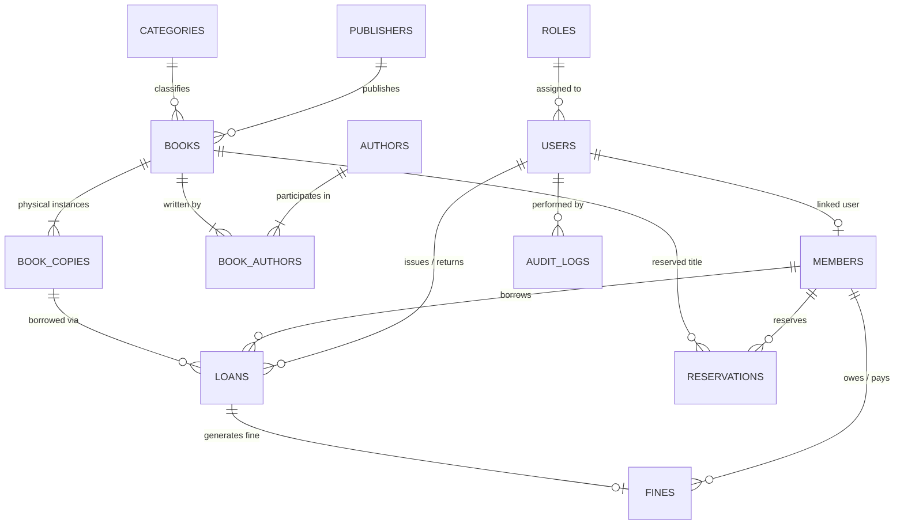

# Database Design Document

## 1. Relational Schema Architecture

The database architecture is designed specifically for **PostgreSQL 16** with 3NF normalization, referential integrity cascades, and specialized performance indexing.

---

## 2. Table Specifications

### 2.1 `roles`
Stores application roles (`ADMIN`, `LIBRARIAN`, `MEMBER`).
- `id` (SERIAL, PK)
- `name` (VARCHAR(50), UNIQUE, NOT NULL)
- `description` (TEXT)
- `created_at` (TIMESTAMPTZ, DEFAULT CURRENT_TIMESTAMP)

### 2.2 `users`
System login accounts with salted BCrypt password hashes.
- `id` (BIGSERIAL, PK)
- `username` (VARCHAR(50), UNIQUE, NOT NULL)
- `email` (VARCHAR(150), UNIQUE, NOT NULL)
- `password_hash` (VARCHAR(255), NOT NULL)
- `role_id` (INT, FK -> roles.id, NOT NULL)
- `first_name` (VARCHAR(100), NOT NULL)
- `last_name` (VARCHAR(100))
- `phone` (VARCHAR(25))
- `is_active` (BOOLEAN, DEFAULT true)
- `created_at`, `updated_at` (TIMESTAMPTZ)

### 2.3 `members`
Library patrons with institutional membership numbers.
- `id` (BIGSERIAL, PK)
- `user_id` (BIGINT, UNIQUE, FK -> users.id, ON DELETE SET NULL)
- `membership_number` (VARCHAR(50), UNIQUE, NOT NULL)
- `first_name`, `last_name` (VARCHAR(100), NOT NULL)
- `email` (VARCHAR(150), UNIQUE, NOT NULL)
- `phone` (VARCHAR(25))
- `address` (TEXT)
- `membership_start_date` (DATE, NOT NULL)
- `membership_expiry_date` (DATE, NOT NULL)
- `status` (VARCHAR(20), CHECK status IN ('ACTIVE', 'INACTIVE', 'SUSPENDED', 'EXPIRED'))
- `created_at`, `updated_at` (TIMESTAMPTZ)

### 2.4 `categories`
Hierarchical catalog classifications.
- `id` (SERIAL, PK)
- `name` (VARCHAR(100), UNIQUE, NOT NULL)
- `description` (TEXT)
- `created_at` (TIMESTAMPTZ)

### 2.5 `authors`
Book authors with biographical profiles.
- `id` (SERIAL, PK)
- `first_name` (VARCHAR(100), NOT NULL)
- `last_name` (VARCHAR(100))
- `biography` (TEXT)
- `nationality` (VARCHAR(100))
- `created_at` (TIMESTAMPTZ)

### 2.6 `publishers`
Publishing houses and metadata.
- `id` (SERIAL, PK)
- `name` (VARCHAR(150), UNIQUE, NOT NULL)
- `contact_email` (VARCHAR(150))
- `phone` (VARCHAR(25))
- `website` (VARCHAR(255))
- `address` (TEXT)
- `created_at` (TIMESTAMPTZ)

### 2.7 `books`
Bibliographical records (the title/work entity).
- `id` (BIGSERIAL, PK)
- `isbn` (VARCHAR(20), UNIQUE)
- `title` (VARCHAR(255), NOT NULL)
- `subtitle` (VARCHAR(255))
- `category_id` (INT, FK -> categories.id, ON DELETE RESTRICT)
- `publisher_id` (INT, FK -> publishers.id, ON DELETE SET NULL)
- `publication_year` (INT, CHECK BETWEEN 1000 AND 2100)
- `edition` (VARCHAR(50))
- `language` (VARCHAR(50), DEFAULT 'English')
- `description` (TEXT)
- `shelf_location` (VARCHAR(50))
- `cover_image_url` (VARCHAR(500))
- `is_active` (BOOLEAN, DEFAULT true)
- `created_at`, `updated_at` (TIMESTAMPTZ)

### 2.8 `book_authors` (Many-to-Many Bridge)
- `book_id` (BIGINT, FK -> books.id, ON DELETE CASCADE)
- `author_id` (INT, FK -> authors.id, ON DELETE CASCADE)
- Primary Key: `(book_id, author_id)`

### 2.9 `book_copies` (Physical Copy Tracking)
Distinct physical book instances tracked with unique accession barcodes.
- `id` (BIGSERIAL, PK)
- `book_id` (BIGINT, FK -> books.id, ON DELETE CASCADE)
- `accession_number` (VARCHAR(50), UNIQUE, NOT NULL)
- `status` (VARCHAR(20), CHECK IN ('AVAILABLE', 'BORROWED', 'RESERVED', 'LOST', 'DAMAGED', 'MAINTENANCE'))
- `condition` (VARCHAR(50), DEFAULT 'Good')
- `acquisition_date` (DATE, DEFAULT CURRENT_DATE)
- `price` (NUMERIC(10,2))
- `created_at`, `updated_at` (TIMESTAMPTZ)

### 2.10 `loans` (Circulation Transactions)
- `id` (BIGSERIAL, PK)
- `book_copy_id` (BIGINT, FK -> book_copies.id, ON DELETE RESTRICT)
- `member_id` (BIGINT, FK -> members.id, ON DELETE RESTRICT)
- `issued_by` (BIGINT, FK -> users.id, ON DELETE SET NULL)
- `returned_by` (BIGINT, FK -> users.id, ON DELETE SET NULL)
- `issue_date` (DATE, NOT NULL, DEFAULT CURRENT_DATE)
- `due_date` (DATE, NOT NULL)
- `return_date` (DATE)
- `status` (VARCHAR(20), CHECK IN ('ACTIVE', 'RETURNED', 'OVERDUE', 'LOST'))
- `notes` (TEXT)
- `created_at`, `updated_at` (TIMESTAMPTZ)

### 2.11 `fines`
Financial penalties computed with high-precision arithmetic.
- `id` (BIGSERIAL, PK)
- `loan_id` (BIGINT, UNIQUE, FK -> loans.id, ON DELETE CASCADE)
- `member_id` (BIGINT, FK -> members.id, ON DELETE CASCADE)
- `amount` (NUMERIC(10,2), NOT NULL, CHECK >= 0)
- `paid_amount` (NUMERIC(10,2), DEFAULT 0, CHECK >= 0)
- `reason` (TEXT, NOT NULL)
- `status` (VARCHAR(20), CHECK IN ('UNPAID', 'PAID', 'PARTIALLY_PAID', 'WAIVED'))
- `payment_method` (VARCHAR(50))
- `receipt_number` (VARCHAR(100))
- `created_at`, `paid_at` (TIMESTAMPTZ)

### 2.12 `reservations`
Priority hold requests for loaned or unavailable titles.
- `id` (BIGSERIAL, PK)
- `book_id` (BIGINT, FK -> books.id, ON DELETE CASCADE)
- `member_id` (BIGINT, FK -> members.id, ON DELETE CASCADE)
- `reservation_date` (TIMESTAMPTZ, DEFAULT CURRENT_TIMESTAMP)
- `status` (VARCHAR(20), CHECK IN ('WAITING', 'READY_FOR_PICKUP', 'FULFILLED', 'CANCELLED', 'EXPIRED'))
- `priority` (INT, DEFAULT 1)
- `notification_sent_at` (TIMESTAMPTZ)
- `pickup_deadline` (DATE)
- `notes` (TEXT)
- `created_at`, `updated_at` (TIMESTAMPTZ)

### 2.13 `library_settings`
Configurable operational parameters (key-value store).
- `setting_key` (VARCHAR(50), PK)
- `setting_value` (VARCHAR(255), NOT NULL)
- `description` (TEXT)
- `updated_at` (TIMESTAMPTZ)

### 2.14 `audit_logs`
Immutable compliance and security trail.
- `id` (BIGSERIAL, PK)
- `user_id` (BIGINT, FK -> users.id, ON DELETE SET NULL)
- `action` (VARCHAR(100), NOT NULL)
- `entity` (VARCHAR(50), NOT NULL)
- `entity_id` (BIGINT)
- `details` (TEXT)
- `ip_address` (VARCHAR(45))
- `created_at` (TIMESTAMPTZ, DEFAULT CURRENT_TIMESTAMP)

---

## 3. Database Indexing Strategy

To guarantee millisecond query performance on large catalogs:
- `idx_books_category`: `CREATE INDEX idx_books_category ON books(category_id);`
- `idx_books_title`: `CREATE INDEX idx_books_title ON books(LOWER(title));`
- `idx_books_isbn`: `CREATE INDEX idx_books_isbn ON books(isbn);`
- `idx_book_copies_book`: `CREATE INDEX idx_book_copies_book ON book_copies(book_id);`
- `idx_book_copies_status`: `CREATE INDEX idx_book_copies_status ON book_copies(status);`
- `idx_loans_member_status`: `CREATE INDEX idx_loans_member_status ON loans(member_id, status);`
- `idx_loans_due_date`: `CREATE INDEX idx_loans_due_date ON loans(due_date) WHERE status = 'ACTIVE';`
- `idx_fines_member_status`: `CREATE INDEX idx_fines_member_status ON fines(member_id, status);`
- `idx_reservations_book_status`: `CREATE INDEX idx_reservations_book_status ON reservations(book_id, status);`
